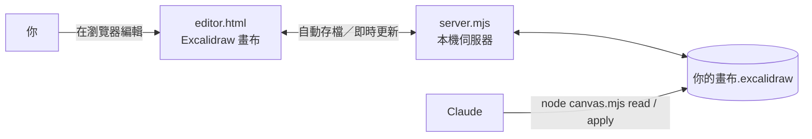

# 節點畫布（node-canvas）

在瀏覽器裡用 [Excalidraw](https://excalidraw.com) 畫心智圖／流程圖，畫布檔（`.excalidraw`）存在自己的電腦。**你和 AI（Claude 等）一起編輯同一張畫布**：AI 用指令讀取和修改，你的畫面即時更新；你在畫面上調整，AI 下次讀取就看得到。

- 分支可以像 Xmind 一樣收合、展開，「只看主幹」「展開到第二層」一鍵切換
- 自動排版（ELK），新節點自動接在父節點旁
- 匯入 Xmind 心智圖（含圖片、收合狀態）
- 每次 AI 修改前自動備份，畫面上也能 Ctrl＋Z 復原 AI 的修改
- 不需要帳號、不上傳雲端，檔案都在你自己的電腦

## 需要

- [Node.js](https://nodejs.org) LTS 版（18 以上）
- 網路：畫布畫面的程式（Excalidraw）從網路載入，離線開不起來

## 安裝

```bash
git clone https://github.com/philko2017/node-canvas.git
cd node-canvas
npm install
```

不會用 Git 的話，也可以在 GitHub 頁面按「Code → Download ZIP」，解壓縮後在資料夾裡執行 `npm install`。

## 開啟畫布

**Windows**：把畫布檔（`.excalidraw`）**拖到「開啟畫布.cmd」上**，瀏覽器就會打開畫布。

- 也可以雙擊「開啟畫布.cmd」，再把畫布檔拖進視窗、按 Enter。
- 輸入一個還不存在的檔名，會建立新的空白畫布。
- 第一次使用會自動安裝套件，要等一下。
- 黑色視窗開著時畫布才能用，用完直接關掉它。

**macOS、Linux**：

```bash
node server.mjs 你的畫布.excalidraw 5180 --open
```

想先試試看，可以打開附的範例：`node server.mjs examples/範例心智圖.excalidraw 5180 --open`

同時開好幾張畫布時，每張用不同的埠（5180、5181…）。

## 在畫布上編輯

- **自動存檔**：停手約半秒後自動存回檔案，畫面下方會顯示「已存檔」和時間。
- **一個方框就是一個節點**：文字第一行是名稱，空一行之後是說明。
- 選取節點後按 **Ctrl＋方向鍵**，可以往那個方向長出新節點並自動連線。
- **Shift＋1**：把所有內容移到畫面中間並縮放到剛好；**Shift＋2**：只看選取的節點。
- **收合分支**：點節點右邊的 **−** 收合，**＋數字** 展開（數字是藏了幾個節點）。右上角「分支」面板可以「只看主幹」「展開到第二層」「全部展開」。
  - 收合不會刪任何東西，藏起來的節點還在檔案裡。
  - 「自動排版」打勾時，收合或展開後會把看得到的節點重新排整齊；鎖定的節點不會動。不想動到你調好的位置就取消勾選。
  - 收合是在伺服器端改檔，Ctrl＋Z 復原不了；要復原就再按一次那顆鈕。
- **字型**：選取節點後在左邊「字體集」切換。選 **A（Nunito）** 時，中文會用電腦內建的黑體（Mac 蘋方、Windows 微軟正黑體）；選 ✏️ 是手寫風。AI 新增的節點預設用黑體。
- AI 改了畫布時，畫面會自動更新，右下角會提示；可以按 Ctrl＋Z 復原 AI 的修改。

## 和 Claude 協作

這個工具的重點是讓 AI 幫你做「大量、結構性」的工作（新增整個分支、重新歸類、匯入、整理錯字），你負責在畫面上微調。



Claude 不需要任何外掛或 API 金鑰，它只是在這個資料夾裡執行 `node canvas.mjs` 指令。操作規則都寫在 [`AGENTS.md`](AGENTS.md)，`CLAUDE.md` 會讓 Claude 自動讀到它。

### 方式一：Claude 桌面版（Code 分頁）

1. 安裝 [Claude 桌面版](https://claude.ai/download)，切到 **Code** 分頁。
2. 選擇這個工具的資料夾（`node-canvas`）當工作資料夾。
3. 直接用中文說你要做什麼，例如「幫我開 D:\筆記\讀書計畫.excalidraw」。Claude 會自己啟動畫布、打開瀏覽器。

### 方式二：Claude Code（終端機）

```bash
npm install -g @anthropic-ai/claude-code
cd node-canvas
claude
```

在這個資料夾啟動 `claude`，它就會讀到 `CLAUDE.md` → `AGENTS.md`，知道怎麼操作畫布。

### 可以這樣跟 Claude 說

| 你想做的事 | 可以這樣說 |
|---|---|
| 開畫布 | 「幫我開 `~/筆記/專案規劃.excalidraw`，沒有的話就建一張新的」 |
| 新增內容 | 「在『行銷』底下加三個子節點：社群、廣告、口碑，每個寫兩行說明」 |
| 整理結構 | 「讀完整張圖，告訴我你會怎麼重新歸類，先不要改」→「照這個方案做，先做在副本上讓我確認」 |
| 匯入 Xmind | 「把 `~/Downloads/讀書筆記.xmind` 匯入成畫布」 |
| 批次修改 | 「把整張畫布換成黑體」「幫我找出錯字並修正」「所有『待辦』節點改成紅色」 |
| 排版 | 「全部重排」（預設 AI 只排新節點，不動你調好的位置） |

### 其他 AI 工具

Google Antigravity、Cursor、Codex 等支援 `AGENTS.md` 的工具也能用：把 `AGENTS.md` 設成規則，或在對話一開始請它先讀這個檔案。

### 安全網

- AI 每次用 `canvas.mjs` 修改前，都會把原檔備份到畫布旁邊的 `.canvas-history/` 資料夾。
- 畫面上可以按 Ctrl＋Z 復原 AI 的修改。
- 大改（例如重新歸類）可以請 Claude「先做在副本上」，確認後再取代原檔。

## 匯入 Xmind

```bash
node canvas.mjs import 你的心智圖.xmind 新畫布.excalidraw
```

- 照 Xmind 的層級建立節點並排版，Xmind 裡收合的分支也照樣收合。
- 多行標題的第一行當名稱，其餘當說明；備註、標籤、連結放進說明。
- 圖片放在節點正下方、和節點同一個群組（拖節點時一起動，收合時一起藏）。大圖會縮到最長邊 1200 像素，畫布檔才不會太大。
- 關係線不會轉過來。只支援新版 Xmind（Xmind 8 的舊檔請先用新版打開再存一次）。

## 在不同電腦使用

- **搬工具**：每台電腦 `git clone` 一份，更新時 `git pull`。
- **共用畫布**：畫布檔放在 Git 版本庫或雲端硬碟同步資料夾。同一時間只能一台電腦開著編輯，不然兩邊會互相覆蓋。
- **只用即時畫布編輯**：VS Code 的 Excalidraw 擴充套件、excalidraw.com 只在開檔時讀一次，存檔會蓋掉 AI 的修改。

## 檔案

| 檔案 | 用途 |
|---|---|
| `開啟畫布.cmd` | Windows 一鍵開啟 |
| `server.mjs` | 本機小伺服器：畫面和檔案同步、收合 |
| `editor.html` | 瀏覽器裡的畫布畫面 |
| `canvas.mjs` | 讀畫布、套用修改、自動排版、匯入 Xmind（AI 用的指令） |
| `AGENTS.md` | 給 AI 的操作說明（`CLAUDE.md` 會引用它） |
| `examples/` | 範例畫布 |

## 授權

[MIT](LICENSE) © 2026 Phil

使用的套件：[Excalidraw](https://github.com/excalidraw/excalidraw)（MIT，從 esm.sh 載入）、[elkjs](https://github.com/kieler/elkjs)（EPL-2.0，自動排版）。
